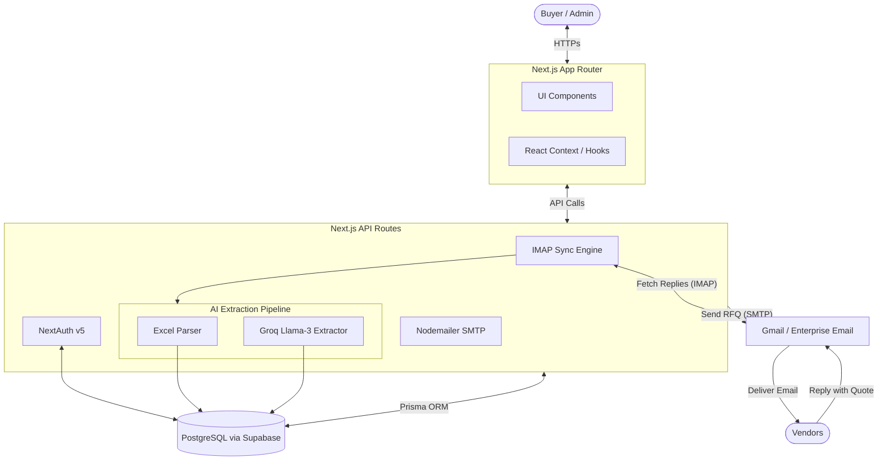

# RFQPilot ✈️ 

RFQPilot is a smart, Gmail-styled procurement platform built to automate Request For Quote (RFQ) processes. It allows procurement teams to draft RFQs, track vendor communications, and automatically ingest emailed vendor quotes via a powerful AI-driven extraction pipeline.

## 🚀 Features
- **Gmail-Inspired UI:** Familiar Inbox, Sent, Drafts, and Review queues for intuitive navigation, featuring both Light and Dark modes.
- **Smart Inbox Syncing:** Connects directly via IMAP to your procurement email to monitor vendor replies.
- **AI Extraction Pipeline:** Automatically extracts line items, quantities, and prices from vendor emails and Excel attachments using **Groq (Llama 3)** and ExcelJS.
- **Automated Comparisons:** Side-by-side vendor quoting comparison matrix with one-click Excel export.
- **Secure Authentication:** Powered by NextAuth v5 with role-based access.

---

## 🏗️ Architecture Diagram



---

## 💻 Tech Stack
- **Framework:** Next.js 14+ (App Router)
- **Language:** TypeScript
- **Styling:** Tailwind CSS + Shadcn/ui
- **Database:** PostgreSQL (Hosted on Supabase)
- **ORM:** Prisma
- **Authentication:** NextAuth.js (v5)
- **Email:** Nodemailer (SMTP), ImapFlow (IMAP)
- **AI Integration:** Groq SDK

---

## 🛠️ Getting Started (Local Development)

### 1. Prerequisites
- Node.js (v18 or higher)
- A Supabase account (for PostgreSQL database)
- A Groq account (for AI API Key)
- An email account with an App Password (e.g. Gmail)

### 2. Clone and Install
```bash
git clone https://github.com/AdityaK05/RFQ_Automation.git
cd RFQ_Automation/rfq-app
npm install
```

### 3. Environment Variables
Copy the example environment file and fill in your credentials.
```bash
cp .env.example .env
```
Ensure you have the following populated in `.env`:
- `DATABASE_URL` and `DIRECT_URL` (From Supabase)
- `AUTH_SECRET` (Run `npx auth secret` to generate)
- `SMTP_*` and `IMAP_*` (Your email App Password credentials)
- `GROQ_API_KEY` (From Groq Console)

### 4. Database Setup
Push the schema to your Supabase database and seed it with initial admin users and dummy data:
```bash
npx prisma db push
npx prisma db seed
```

### 5. Run the Application
```bash
npm run dev
```
Open [http://localhost:3000](http://localhost:3000) with your browser.

**Default Login:**
- **Email:** `admin@rfqpilot.com`
- **Password:** `rfqpilot2026`

---

## 💡 How It Works (End-to-End Flow)
1. **Create an RFQ:** The Buyer creates an RFQ, adding multiple line items, and selects Vendors.
2. **Send:** The app dynamically generates a custom Excel Template and emails it to the Vendors via SMTP.
3. **Vendor Reply:** The Vendor fills out the Excel sheet (or types a response) and replies to the email.
4. **Sync & Extract:** The app connects via IMAP to pull the unread reply. It detects the Excel sheet or reads the email body, passing it to the **Groq AI Pipeline** to parse the quote data into structured rows.
5. **Review:** The parsed quote lands in the **Review Queue**. Once approved by the Buyer, it populates the main comparison matrix!
